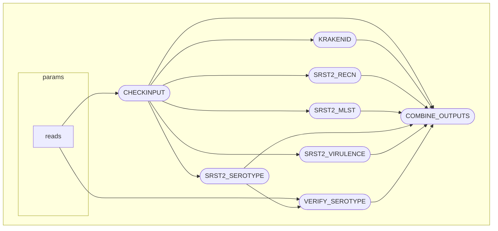

[](https://github.com/aphascience/Strepsuis_seq/actions/workflows/maintest.yml)


## Strepsuis_seq

This is the repo for APHA's Nextflow implementation of the [_Streptococcus suis_ serotyping pipeline](https://github.com/streplab/SsuisSerotyping_pipeline).  It essentially makes use of SRST2 to map reads to mlst, virulence and serotyping databases. To reduce running time input files are downsampled if required and Kraken2 is used to confirm species ID alongside the presence of a recN allele thought to be species specific.  Some serotypes can only be differentiated based on a single SNP and this is achived using a bespoke module.

Calculations of best match are in the [SRST2 publication](
https://genomemedicine.biomedcentral.com/articles/10.1186/s13073-014-0090-6)

srst2 processes are run in parallel and all data are collated onto a final output file.



# Quick start

As this pipeline has been built in Nextflow, there are minimal requirements to get started.  The only prerequisites are [Nextflow](https://www.nextflow.io/) (requires Java >= v17) and [Docker](https://www.docker.com/). Then the pipeline can be run using the following:

```
nextflow run aphascience/Strepsuis_seq/ -with-docker <docker_registry/imagename> --reads <path_to _reads/*_{S*_R1,S*_R2}*.fastq.gz>
```
The Dockerfile in the repository contains all the information to build the image with required software tools, and the relavent databases for srst2 are in the 'assets' directory.

_Streptococcus suis_ MLST database last updated 01-Oct-25 from: [_Streptococcus suis_ pubMLST](https://pubmlst.org/organisms/streptococcus-suis)

